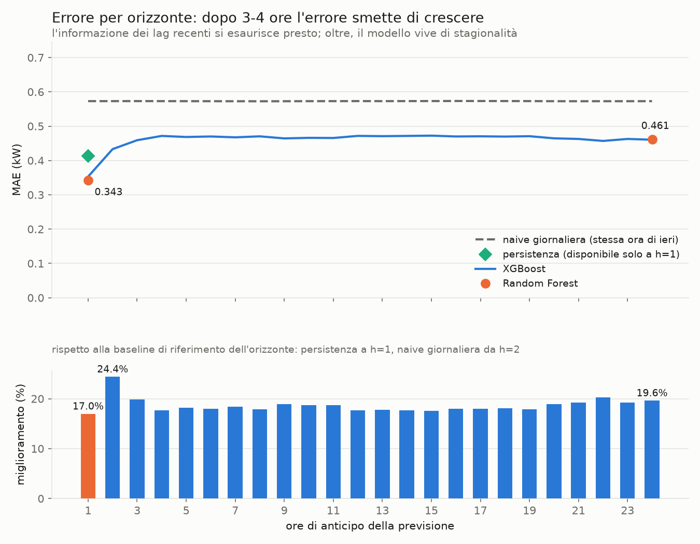
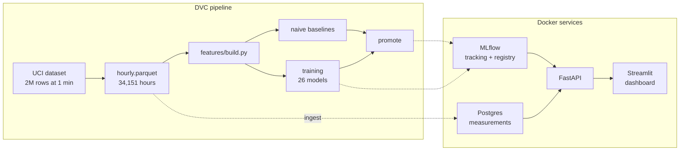

# Energy Consumption Forecasting

[](https://github.com/DanieleSchingaro/energy-forecasting-mlops/actions/workflows/ci.yml)

Forecasting household electricity demand for each of the next 24 hours, from the
raw dataset through to a queryable API and a dashboard.

The model is not what this project is about — that part is twenty lines of
scikit-learn. It is about everything around it: a reproducible pipeline, an honest
comparison against naive baselines, a registry the service pulls its models from,
and a single feature module shared between training and inference.

## Results

Test set: the last 12 months of data (8,760 hours, starting 2009-11-26 21:00), never
seen during training or cross-validation. Metric: MAE in kW, against a mean
consumption of 1.08 kW.

| Horizon | Champion model | MAE | Reference baseline | Baseline MAE | Improvement |
|---:|---|---:|---|---:|---:|
| +1 h | Random Forest | 0.3430 | persistence (`naive_1h`) | 0.4131 | **+17.0%** |
| +2 h | XGBoost | 0.4332 | same hour yesterday (`naive_24h`) | 0.5730 | **+24.4%** |
| +3 h | XGBoost | 0.4591 | `naive_24h` | 0.5731 | **+19.9%** |
| +6 h | XGBoost | 0.4700 | `naive_24h` | 0.5728 | **+18.0%** |
| +12 h | XGBoost | 0.4717 | `naive_24h` | 0.5731 | **+17.7%** |
| +24 h | XGBoost | 0.4605 | `naive_24h` | 0.5729 | **+19.6%** |

Across all 24 horizons: mean MAE 0.4606 kW and a mean improvement over the baseline
of **18.6%**, with the smallest gain (17.0%) at one hour ahead, where the baseline is
the hardest of the three to beat. The full table is in
[`reports/mae_by_horizon.csv`](reports/mae_by_horizon.csv) and the raw figures in
[`reports/model_metrics.json`](reports/model_metrics.json).



Three things the curve says:

- **Error grows by a third over the first four hours, then flattens.** From 0.34 kW
  at one hour to 0.47 kW at four, and a plateau after that. Beyond three or four
  hours the last observed value stops carrying information and the model lives on
  calendar features and rolling means, so extending the horizon from 6 to 18 hours
  costs almost nothing.
- **The improvement climbs back up around 22-24 hours.** That is no accident: at
  `h = 24` the `lag_0h` feature becomes "same hour yesterday" — precisely what the
  seasonal baseline uses, except the model combines it with everything else instead
  of copying it.
- **Random Forest only runs at the two extremes, as a control.** It wins at one hour
  (0.3430 against XGBoost's 0.3530) and ties at twenty-four (0.4611 against 0.4605),
  for 7 seconds of training instead of 0.8. Hence the configuration: XGBoost on every
  horizon, Random Forest at `h=1` and `h=24` for comparison. This is two models under
  these conditions, not a verdict on the algorithms.

### About the baseline, which is the most important part of that table

An earlier version of this project claimed a 40% improvement at one hour. The number
was true and meaningless at the same time: it compared against "same hour yesterday",
a baseline nobody would use one hour out. Anyone forecasting the next hour starts from
the hour just gone — persistence. Measured against that, the gain drops to 17%, and
17% is the real number.

Hence the design: three baselines computed for every horizon (persistence, daily
seasonal, weekly seasonal), the strongest available one kept as the reference, and the
inapplicable ones excluded by construction. Persistence at +6 hours would require a
value not yet observed at prediction time, so `seasons_for_horizon()` drops it rather
than handing the model an easy comparison. The choice is a parameter
(`evaluation.reference_baseline`), not a line buried in the code.

The same principle governs promotion: a model is only given the champion alias if it
beats its horizon's reference baseline. If it does not, the baseline is what you would
rather deploy, and the registry stays empty for that hour.

## Exploratory analysis

[`notebooks/01_eda.ipynb`](notebooks/01_eda.ipynb) demonstrates the claims this README
makes in prose: the autocorrelation peaks at 24 and 168 hours that motivate the lag
set, the daily and weekend profiles behind the calendar features, the annual cycle that
makes a 12-month test window the honest choice, and the gap propagation that explains
why 88.9% of test hours are evaluated rather than 98.7%.

The notebook imports `energy.features.build` instead of rebuilding features of its own,
and cross-checks its own count of evaluable hours against the one written by the
pipeline — so if the two ever disagree, the notebook says so.

## Architecture



Four containers, defined in [`docker-compose.yml`](docker-compose.yml) and started in
order through healthchecks:

| Service | Role |
|---|---|
| `postgres` | two databases: the hourly measurements and MLflow's backend store |
| `mlflow` | tracking server, Model Registry and artifact store (`--serve-artifacts`) |
| `api` | FastAPI; loads the champions from the registry at startup, reads the window from the database |
| `dashboard` | Streamlit; talks only to the API over HTTP, knows nothing about models or the database |

How a forecast flows: the dashboard calls `/forecast`, the API reads the 169 hours
preceding the requested instant from the database, passes them through the same feature
module used in training, queries the 24 champions and returns 24 predictions. The models
are not files in this repository — they are versions in the registry, resolved by the
alias `champion-h{1..24}`.

## Design decisions

**Direct multi-horizon forecasting.** One model per hour, from `h=1` to `h=24`, rather
than one recursive model called twenty-four times on its own predictions. The direct
approach does not accumulate error, and it lets each horizon lean on the features that
actually help it: the last observed value at one hour, the calendar at twenty-four. It
costs 26 fits instead of one — XGBoost on every horizon, Random Forest at `h=1` and
`h=24` for comparison — which at this data volume is a few minutes including
cross-validation, and yields 24 registered champions.

**The split is on target time, not emission time.** A forecast issued at 23:00 on
2009-11-26 for 10:00 the next day belongs to the test set even though it was issued
before the cutoff. Conflating the two moves test hours into training — a mistake that
hides well, because the metrics stay plausible and merely come out better than they
should. `is_test(index, horizon, split)` applies the cutoff to `t + h`.

**Rolling-origin cross-validation with a gap.** `TimeSeriesSplit` with five folds and
`gap=24` hours between train and validation. Without the gap, the last training hours
and the first validation hours share rolling windows and the score comes out optimistic.

**One feature module.** `energy.features.build` is imported by training, by the
baselines and by the API. There is no second implementation to keep in sync, which is
the most common way a model that looked good in a notebook turns mediocre in production.

**Leakage is tested, not asserted.** `tests/test_features.py` builds the feature matrix,
perturbs future values of the series and checks that no feature changes. Rolling windows
use `min_periods=window`, so incomplete leading windows stay `NaN` instead of being
filled with partial information.

**Coverage is stated.** Of the 8,760 test hours, 7,789 are evaluated (88.9%). The rest
fall in gaps in the original dataset, where neither a ground-truth value nor a complete
history window exists. Models and baselines are always scored on the same hours.

## Reproducing

Requires Python 3.11, Docker and Git. On Windows, run the `.sh` scripts from Git Bash.

```bash
git clone https://github.com/DanieleSchingaro/energy-forecasting-mlops.git
cd energy-forecasting-mlops
python -m venv .venv && source .venv/bin/activate   # Windows: .venv\Scripts\activate
python -m pip install -r requirements-dev.txt
python -m pip install -e .
```

Then the services. `.env.example` holds placeholder values only: copy it to `.env` and
fill in real passwords. `.env` is never committed.

```bash
cp .env.example .env        # choose your passwords
docker compose up -d --build
```

MLflow comes up on http://localhost:5000. Now the pipeline:

```bash
bash scripts/run_all.sh     # tests, then dvc repro, then the metrics
python -m energy.report     # reports/summary.md, the table and the figure
```

`dvc repro` runs `download`, `make_dataset`, `baseline`, `train`, `promote` and `ingest`
in order, skipping any stage whose inputs have not changed — so changing a
hyperparameter in `configs/params.yaml` retrains without re-downloading 133 MB of data.
The `ingest` stage writes to the database and the training stage registers models with
MLflow, which is why the containers come up before the pipeline rather than after. The
script runs under `tmux` when available, since the whole pipeline takes a few minutes
and a dropped connection should not interrupt it.

One step remains, because the API loads its champions at startup:

```bash
docker compose restart api
```

API on http://localhost:8000/docs, dashboard on http://localhost:8501.

## API

| Endpoint | Description |
|---|---|
| `GET /health` | status of the service, the database and the registry |
| `GET /models` | loaded champions, with version and horizon |
| `GET /forecast?issued_at=...` | 24 forecasts from the given instant |
| `GET /measurements?start=...&end=...` | observed history |
| `POST /measurements` | insert or update measurements |

The history window does not travel in the request: the client sends an instant and the
API fetches the 169 hours it needs from the database. This is the realistic version — a
client made to ship 169 correctly ordered values would be reimplementing the service's
own logic, and sooner or later would do it differently.

```bash
curl "http://localhost:8000/forecast?issued_at=2010-11-20T12:00:00"
```

```json
{
  "issued_at": "2010-11-20T12:00:00",
  "window": { "start": "2010-11-13T12:00:00", "hours": 169 },
  "forecasts": [
    { "horizon": 1, "target_time": "2010-11-20T13:00:00", "prediction": 1.42,
      "model": "random_forest", "model_version": "1" }
  ]
}
```

When the required hours are missing from the database the API does not guess: it returns
422 with the expected window, the window it found, and the missing hours.

## Repository layout

```
configs/params.yaml        single source for split, features, hyperparameters, MLflow
src/energy/
  data/                    download, hourly aggregation, database ingestion
  features/build.py        feature construction and supervised dataset
  evaluation.py            temporal split, naive baselines, metrics
  models/                  baselines, training, promotion to the registry
  api/                     FastAPI: service, schemas, endpoints
  db.py                    SQLAlchemy Core, dialect-aware upsert
  report.py                results table and figure
dashboard/app.py           Streamlit, coupled to the API over HTTP only
notebooks/01_eda.ipynb     exploratory analysis
docker/                    Dockerfiles for api, dashboard, mlflow
tests/                     features, evaluation, database, API, dashboard
dvc.yaml                   reproducible pipeline
scripts/run_all.sh         the whole pipeline in one command
```

## Tests and CI

`pytest` covers feature construction (including the anti-leakage test), the temporal
split and the baselines, the database upsert, the API endpoints with fake models
injected through `dependency_overrides`, and the dashboard through
`streamlit.testing.v1.AppTest` — both with the API up and with the API down.

No test needs Postgres or MLflow: the database is in-memory SQLite and the models are
fakes. That is why the CI workflow
([`.github/workflows/ci.yml`](.github/workflows/ci.yml)) declares no services. It runs
`ruff check`, `ruff format --check` and `pytest`, and only if those pass does it build
the two Docker images.

## Dataset

[Individual household electric power consumption](https://archive.ics.uci.edu/dataset/235/individual+household+electric+power+consumption)
(UCI Machine Learning Repository): over two million one-minute measurements collected in
a house near Paris between December 2006 and November 2010, aggregated here into 34,151
hourly records. The target is `global_active_power`, mean active power in kW. The
download is automated — `dvc repro` runs it as the first stage.
